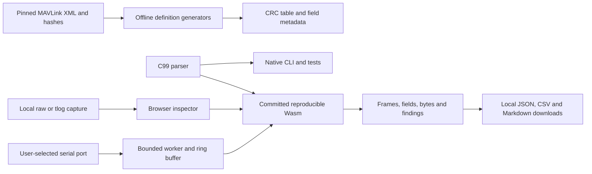

# Mavframe architecture

Mavframe is a local capture inspector. The deployed GitHub Pages site has no
application server, account database or capture upload. The native C library and
the browser use the same `src/mavframe.c` framing and checksum implementation.

The JavaScript layer attaches tlog timestamps, estimates sequence diagnostics,
decodes payload fields from generated metadata and renders results. It does not
replace the C framing/CRC algorithm. CRC detects accidental corruption; it does
not authenticate a sender. A signed MAVLink frame is displayed as unverified.

## Workload and limits

- File input: at most 256 MiB, parsed in chunks with progress and cancellation.
  The file itself remains in browser memory. This is not a streaming storage
  product or a promise that every phone can inspect the maximum file.
- Retained details: first 4,000,000 frames, 100,000 findings and 100,000 sequence
  events; aggregate counters cover the full input. Message/sender grouping is
  bounded to 10,000 groups, with visible truncation. Export is capped at 64 MiB.
- Live serial: 64 KiB parser chunks with acknowledgements, 8 MiB retained tail,
  1 GiB or 30-minute session limit and a 15-second worker response deadline.
  Live rates use browser arrival time. They are not flight-controller timing.
- Fuzz action: exactly 1,000 seeded calls to an independent C/Wasm worker, with
  progress and cancellation. A finite passing corpus is not a safety proof.

The service worker caches an explicit list of public application assets and the
synthetic sample. It never caches private captures. Bump its cache version when
shipping changed assets; existing tabs may need closing before an update applies.

## Optional AWS integration, not deployed

An edge process could use this C library before publishing validated telemetry to
AWS IoT Core; Greengrass could package that process. IoT authorization, identity,
TLS, storage and downstream schema checks would remain separate responsibilities.
Mavframe does not implement an IoT gateway, device authentication or Device
Defender monitoring. See [AWS IoT Core](https://docs.aws.amazon.com/iot/latest/developerguide/what-is-aws-iot.html)
and [Greengrass](https://docs.aws.amazon.com/greengrass/v2/developerguide/what-is-iot-greengrass.html).

## Recovery objectives

There is no server-side user state to restore. Published source and pinned
artifacts are recoverable from Git; no measured hosting RTO is claimed. Unsaved
local captures and live ring-buffer data can be lost on browser shutdown. Export
needed evidence before disconnecting or closing the tab. CI, offline reload and
finite sanitizer/differential tests support release acceptance, not an uptime SLA.
