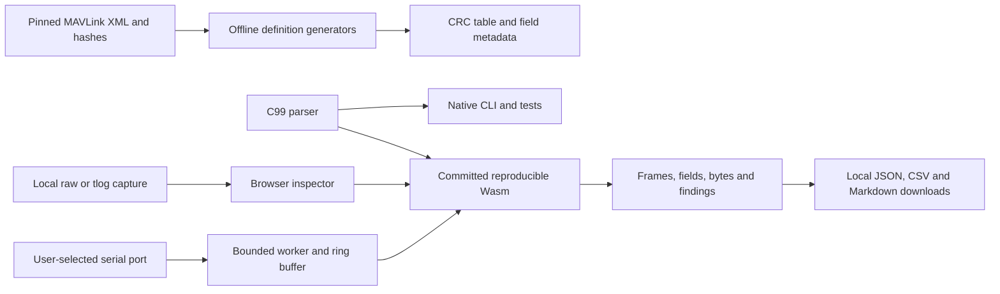
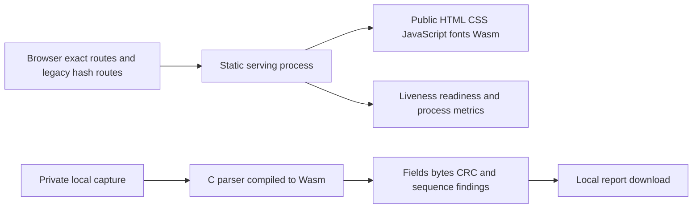

# Mavframe architecture

Mavframe is a local capture inspector. The GitHub Pages deployment has no application server or capture upload. The local
five-app deployment adds a small HTTP serving process for exact-path routing,
process observability and session-owned SQLite workspaces. Explicit saves upload
capture/XML artifacts and actual browser-computed summaries; durable sessions and
logical snapshots survive container recreation on a private volume. Existing browser-local profiles store view settings; optional
cloud synchronization remains separately configured. The native C library and
the browser use the same `src/mavframe.c` framing and checksum implementation.

The JavaScript layer attaches tlog timestamps, estimates sequence diagnostics,
decodes payload fields from generated metadata and renders results. It does not
replace the C framing/CRC algorithm. CRC detects accidental corruption; it does
not authenticate a sender. A signed MAVLink frame is displayed as unverified.

## Workload and limits

- File input: at most 256 MiB, parsed in chunks with progress and cancellation.
  The file itself remains in browser memory. This is not a streaming storage
  product or a promise that every phone can inspect the maximum file.
- Retained details: first 4,000,000 frames, 100,000 findings and 100,000 sequence
  events; aggregate counters cover the full input. Message/sender grouping is
  bounded to 10,000 groups, with visible truncation. Export is capped at 64 MiB.
- Live serial: 64 KiB parser chunks with acknowledgements, 8 MiB retained tail,
  1 GiB or 30-minute session limit and a 15-second worker response deadline.
  Live rates use browser arrival time. They are not flight-controller timing.
- Fuzz action: exactly 1,000 seeded calls to an independent C/Wasm worker, with
  progress and cancellation. A finite passing corpus is not a safety proof.

The service worker caches an explicit list of public application assets and the
synthetic sample. It never caches private captures. Bump its cache version when
shipping changed assets; existing tabs may need closing before an update applies.

## Optional AWS integration, not deployed

An edge process could use this C library before publishing validated telemetry to
AWS IoT Core; Greengrass could package that process. IoT authorization, identity,
TLS, storage and downstream schema checks would remain separate responsibilities.
Mavframe does not implement an IoT gateway, device authentication or Device
Defender monitoring. See [AWS IoT Core](https://docs.aws.amazon.com/iot/latest/developerguide/what-is-aws-iot.html)
and [Greengrass](https://docs.aws.amazon.com/greengrass/v2/developerguide/what-is-iot-greengrass.html).

## Recovery objectives

There is no server-side user state to restore. Published source and pinned
artifacts are recoverable from Git; no measured hosting RTO is claimed. Unsaved
local captures and live ring-buffer data can be lost on browser shutdown. Export
needed evidence before disconnecting or closing the tab. CI, offline reload and
finite sanitizer/differential tests support release acceptance, not an uptime SLA.

## Local product routes and observability

`/`, `/anomalies`, `/stream` and `/system` are explicit server fallbacks. Missing API
requests, assets and unknown routes return 404. Browser navigation uses History API;
legacy hash navigation remains supported. Filters, selected row and bytes/header tab
are URL state, independent between tabs. No global server capture or selection state
is introduced. Replacing a capture clears its derived byte anatomy before any resize
callback can render the new bytes.

The System page fetches `/healthz`, `/readyz`, `/api/system` and `/metrics` with five-second
timeouts and without request caching. It displays the serving process's current data;
CRC/parsing operations occur in the browser and are outside those HTTP counters.
Network errors and dependency failures appear as unavailable checks, with a refresh
action. No historical latency or radio health is inferred from HTTP data.

The service worker caches only its explicit public asset allowlist. Exact-route
navigation can fall back to the cached shell offline; API responses and captures are
never cached. An installed client prepares the complete asset set before declaring
offline readiness and preserves its existing consent/peer-busy update behavior.

The visual identity uses warm sand/amber/obsidian and bundled IBM Plex Sans/Mono.
Font provenance and the SIL Open Font License are in `docs/licenses/IBM-Plex-SOURCE.md`
and `docs/licenses/IBM-Plex-OFL.txt`; no remote font request is needed.

Control-state anomaly detection is not implemented: the anomaly page exposes existing
CRC/sequence findings and names that limit. Physical-radio validation, manual human
screen-reader testing and hosted Kubernetes deployment are not established by browser
checks. Frontend evidence is in `artifacts/verification/post-restart/`.

## Implemented private server mode

Four product routes (`/overview`, `/workbench`, `/reports`, `/settings`) expose actual workflows and stored evidence. Optional server persistence uses SQLite WAL on a private UID10001 volume, opaque durable Beaker sessions and Argon2 accounts. Origin/CSRF/owner checks, quotas and idempotent saves are enforced by the server. No reconnect upload, private signing-key storage or private API caching occurs. Snapshots stay on the same local volume; they are not an independent device backup. See [server workspaces](SERVER_WORKSPACES.md) for contracts, launch, limits and recovery. AWS diagrams elsewhere remain proposals.
