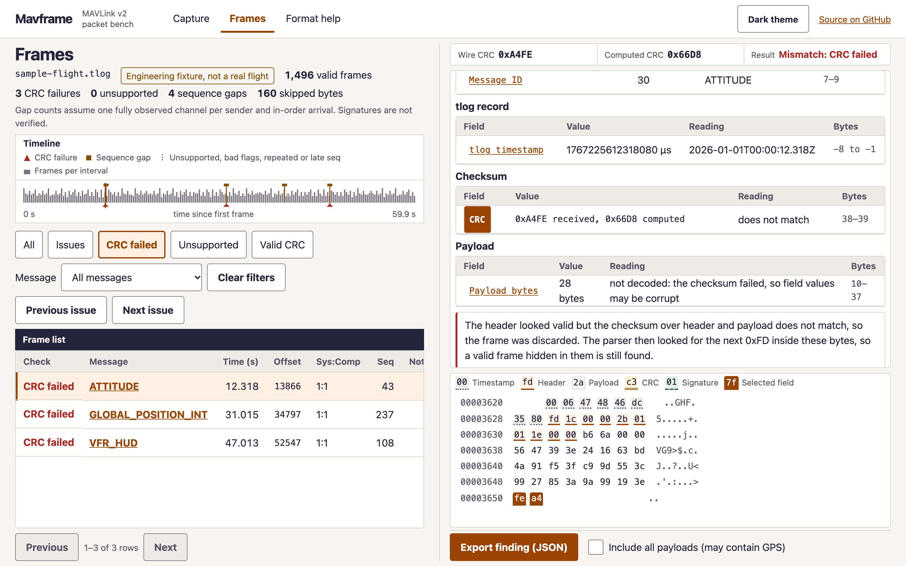

# mavframe

[](https://github.com/anirudh763/mavframe/actions)

A link-quality view of a .tlog: CRC errors and sequence gaps per sender; not a
flight plotter.

mavframe is a dependency-free C99 parser for MAVLink v2 telemetry frames, the
protocol drones use to talk to ground stations. It is written in a firmware
style (no heap allocation, a fixed 280-byte buffer, input accepted one byte at
a time, recovery after corrupted bytes), but it has only been compiled for a
microcontroller, never run on one (see Limitations). It exists to show that
a frame parser can be small enough to read in one sitting and still be checked
against a reference implementation (pymavlink), fuzzed, and measured. It only
finds and checks frames. The library does not decode message fields and it makes no
decisions about what a message means or whether it should be accepted.

The bundled sample flight is synthetic, and no capture from a real radio link
has been tested yet.

Status: beta (0.1.0), maintained by one student, best effort. Tested on x86-64
Linux with gcc and clang. Security reports and the supported scope:
[SECURITY.md](SECURITY.md).

## Quick start

```sh
cmake -S . -B build && cmake --build build        # library, mavframe-dump, tests, benchmark
                                                  # (add -DMAVFRAME_WERROR=ON to make warnings errors, as CI does)
ctest --test-dir build --output-on-failure        # C unit tests

pip install -r requirements-dev.txt               # pymavlink + pytest, tests only
python3 -m pytest tests -v                        # differential tests against pymavlink

python3 bench/gen_stream.py clean 3 sample.bin    # three random valid frames
./build/mavframe-dump sample.bin                  # or: ./build/mavframe-dump < sample.bin
```

Output of the last command (frames on stdout, counters on stderr):

```
bytes=113 frames=3 bad_crc=0 unknown_msgid=0 bad_flags=0 dropped_bytes=0
off=0 msgid=82 sysid=7 compid=140 seq=125 len=39 signed=0 payload=a96089bc4b0d13c91c5f92487b8daf47ec8008c9d8582e48cf161749a8f770c96853154900000d
off=51 msgid=77 sysid=88 compid=142 seq=79 len=10 signed=0 payload=00000300030000009662
off=73 msgid=32 sysid=170 compid=116 seq=148 len=28 signed=0 payload=0100000099d2d8c81c818448f5ff83c8848d7dc89fd70dc98b8fe3c8
```

`mavframe-dump [FILE]` reads stdin when FILE is missing or `-`;
`--help` and `--version` print to stdout and exit 0. A file that cannot be
opened or read gives `mavframe-dump: cannot open <file>: <reason>` and exit
status 1; bad arguments give 2. The input is raw bytes, so a .tlog's 8-byte
timestamps count as dropped bytes (the browser inspector reads .tlog records).

To install the library, header and tool:

```sh
cmake --install build --prefix "$HOME/.local"     # lib/libmavframe.a, include/mavframe.h, bin/mavframe-dump
cc -std=c99 app.c -I"$HOME/.local/include" -L"$HOME/.local/lib" -lmavframe
```

CI does this with clang into a temporary prefix and runs
`tests/install/consumer.c` against the installed files
(`sh tests/install/check_install.sh`). `MAVFRAME_VERSION_STRING` and the
`MAVFRAME_VERSION_MAJOR/MINOR/PATCH` macros in `mavframe.h` give the version
(0.1.0; see `CHANGELOG.md`).

Using the library:

```c
#include "mavframe.h"

mavframe_parser p;
mavframe_init(&p);

/* for each received byte b: */
mavframe_status st = mavframe_feed_byte(&p, b);
while (st != MAVFRAME_NEED_MORE) {
    if (st == MAVFRAME_FRAME) {
        /* mavframe_msgid(&p), mavframe_sysid(&p), mavframe_compid(&p), mavframe_seq(&p),
           mavframe_payload(&p), mavframe_payload_len(&p), mavframe_signed(&p) ... */
    }
    st = mavframe_poll(&p);   /* one byte can release more than one event */
}
```

`mavframe_feed()` takes a whole buffer and gives the same events.
`mavframe_flush()` is for end of stream or a link idle timeout. Statuses other
than `MAVFRAME_FRAME`: `MAVFRAME_BAD_CRC`, `MAVFRAME_UNKNOWN_MSGID` (the id has
no CRC_EXTRA in the table, so the CRC cannot be checked and the frame is not
accepted), `MAVFRAME_BAD_FLAGS` (incompat flags other than "signed"),
`MAVFRAME_DROPPED` (bytes discarded outside any frame).

The CRC_EXTRA table (`src/mavframe_crc_extra_common.h`, 210 messages of the
`common` dialect) is generated from pymavlink 2.4.50:

```sh
python3 tools/gen_crc_extra.py > src/mavframe_crc_extra_common.h
```

## Browser inspector

Live at https://anirudh763.github.io/mavframe/ (GitHub Pages, served from
`docs/` on `main`). Locally: `python3 -m http.server -d docs` and open
http://localhost:8000/.



`docs/` is a static page that runs this parser in the browser: `src/mavframe.c`,
unchanged, compiled to a 4,086-byte WebAssembly module together with a small
glue file (`web/wasm/mavframe_wasm.c`). Open a `.tlog` (an 8-byte big-endian
microsecond timestamp before each frame) or a raw byte stream, or press
**Load engineering sample**. Files are read in the tab and never uploaded.

It works like a packet analyzer (modelled on Wireshark's packet list, packet
details and packet bytes panes):

- **Capture** (`#/capture`): load a file, then the summary counts, the
  assumptions behind them and a message table (count, rate from .tlog
  timestamps, CRC failures, and each sending system:component with its own rate).
- **Frames** (`#/frames`): a timeline with CRC failures and sequence findings
  marked, and one row per valid frame or rejected candidate with its time,
  byte offset, message, sys:comp, sequence number and check (Valid CRC, CRC
  failed, Unsupported, Bad flags). Filter by check or message; the filter,
  page and selection are in the URL, so a view can be shared.
- **Frame details** (`#/frames/<row>`): the header, decoded payload, CRC and
  signature fields next to the hex bytes. Selecting a field highlights its
  bytes; clicking a byte selects its field; with the bytes focused, Left and
  Right move between fields. The CRC from the capture and the CRC computed by
  `mavframe_crc16()` are shown side by side. On windows at least 1200 x 880 px the
  list, field tree and bytes fill the window side by side without page
  scrolling; on smaller windows it is its own screen with Decoded, Bytes and
  Header tabs.
- **Export finding (JSON)**: one row as a portable JSON file with the mavframe
  version, file name, size and SHA-256, offsets, CRC wire vs computed and the
  parser's assumptions. All payload bytes are left out unless you tick
  "Include all payloads"; raw bytes may contain GPS/position or other sensitive
  data. Header-only unsupported/bad-flags candidates cannot export a payload
  or CRC because their frame boundaries are not established.
- **Format help** (`#/help`): the frame layout, what CRC failed vs unsupported
  means, and the sequence-gap assumptions.

The page is light by default; a "Dark theme" toggle switches to dark and is
remembered in the browser. Payload fields are decoded for
HEARTBEAT, SYS_STATUS, GPS_RAW_INT, ATTITUDE, GLOBAL_POSITION_INT and VFR_HUD,
from an excerpt of the official MAVLink XML (`tools/mavlink-xml/`, pinned
commit, SHA-256 checked); `tools/gen_web_defs.py` fails unless field order,
types, length and CRC_EXTRA equal pymavlink's.

The bundled sample is an engineering fixture: `tools/gen_sample_tlog.py`
generates it with known faults (1,496 valid frames, 3 CRC failures, 4 sequence
gaps, 160 skipped bytes), so the tests can check exact counts. It is not a real
flight. A search for a redistributable real MAVLink v2 .tlog found only
MAVLink v1 captures (for example the 5.8 MB `flight.tlog` in the pymavlink and
dronekit-la test data, which this parser reports as 0 valid v2 frames); the
gomavlib, MAVSDK, MAVProxy, QGroundControl, ardupilot, mavlink and
PX4-Autopilot repositories contain no .tlog at all. No real capture is
bundled yet.

What the counts mean:

- **CRC errors**: a candidate frame (a 0xFD start byte, a plausible header and
  enough bytes) whose checksum fails. On a noisy link many of these are random
  bytes that only looked like a header, not damaged real frames. Candidates the
  parser finds inside a frame that already failed its CRC (including a fake
  header there whose own CRC also fails) are part of that one error, not
  separate issues; in .tlog mode, neither are candidates that start inside a
  record's 8 timestamp bytes.
- **Unsupported messages**: a header whose message id is not in the common
  dialect. Its checksum cannot be checked, so it is skipped and not called
  corrupt. The parser checks only such a frame's header, so a 0xFD in its payload can
  look like a frame start; those candidates are not reported as rejects, and
  the frame still counts for sequence tracking when its number is the next one
  (a clean ArduPilot test capture with MEMINFO, id 152, gives 0 rejects and
  0 gaps).
- **Sequence gaps**: per system and component, a forward jump of 2 to 128 in the
  8-bit sequence number. "~N frames missing" assumes frames arrive in order; a
  late frame looks the same, so it is an estimate. It also assumes one fully
  observed channel per sender: routing, filtering or merging links can create
  apparent loss. See the [MAVLink packet-loss assumptions](https://mavlink.io/en/guide/packet_loss.html).
  A repeated number is a
  duplicate, a step back is out of order (or, beyond 16 back, a likely sender
  restart), and 255 to 0 is in order. None of these are counted as CRC errors.
- **Signed frames**: "signature present; not verified". Signatures are carried,
  not checked (that needs the link key).
- MAVLink v1 frames and other bytes count as skipped bytes. In .tlog mode, a
  0xFD byte inside a timestamp that the parser briefly takes for a frame start
  is not reported as a link error (20 in the sample). A test with 2,000 records,
  200 of them corrupted and many timestamps containing 0xFD, reports exactly
  200 CRC errors and no other rejects; so does the reviewer's independent file
  (`tests/web/gen_critic_tlog.py`, seed 9001: 20,000 frames from 3 senders,
  200 corrupted, one of them hiding a fake frame whose CRC also fails).

Captures up to 256 MB are accepted; larger files get a message instead. Parsing
runs in 512 kB chunks with a progress bar and a Cancel button. Details are kept
for the first 4,000,000 frames and 100,000 issues; the counts cover everything.

The sample is synthetic and labelled so on the page: 60 seconds of made-up
telemetry for a quadrotor (computed by the script, not taken from a simulator or
a real flight), packed by pymavlink
(`tools/gen_sample_tlog.py`), with three frames altered after packing, one frame
never written and one MAVLink v1 record. The page reports what the generator
wrote: 1,496 valid frames, 3 CRC errors, 4 sequence gaps (~4 frames missing: the
dropped frame and the three corrupted ones), 0 duplicates, 0 out of order,
160 skipped bytes. pymavlink's own .tlog reader also finds 1,496 valid frames.

```sh
pip install ziglang==0.17.1
sh tools/build_wasm.sh                 # docs/mavframe.wasm (byte-for-byte reproducible)
cmake --build build                    # also builds build/glue_dump: the same glue, native
node --test tests/web/test_wasm.mjs    # 18 tests
node --test tests/web/test_ui.mjs      # 17 tests in Chromium (Playwright) + axe-core, 1 optional screenshot step
```

- The wasm and native builds of the same files give identical events (offset,
  id, status, header fields, length) and counters on the sample, a corrupted
  3,000-frame stream, signed frames and malformed input, fed in reads of 1, 2, 3,
  7, 10, 13, 255 and 4,096 bytes and in one piece (43,812 events compared), and
  with the stream split into two reads at every byte boundary of two test
  streams (195 and 539 split points). CI rebuilds the wasm and fails if it
  differs from the committed file.
- Decoded fields of 51 sample frames equal pymavlink's values.
- Sequence regression cases (one component): 10, 11 is in order; 10, 10, 11 is
  one duplicate; 10, 9, 11 is one out-of-order frame; 255, 0 is in order; 10, 13
  is one gap of ~2; 200, 150, 151 is one likely restart. The commit before this
  fix reported 255 missing frames for the duplicate and out-of-order cases.
- Browser tests: exact counts for the sample; keyboard-only use; no horizontal
  scrolling at 320 and 375 px, at 200% page zoom and with 200% text size; empty
  file, non-MAVLink file, oversized file, sample and wasm download failures;
  Cancel; signed and unsupported frames; a 52 MB capture with the longest
  main-thread block under 250 ms (126 ms in the last run here); with
  JavaScript off, a `<noscript>` message says why nothing works. axe-core 4.14
  reports 0 violations in light and dark mode at 1280 and 375 px. These are
  automated checks; a manual screen-reader check was not run.

The page sets a Content-Security-Policy: only its own files load, no inline
scripts or styles, and WebAssembly compilation is allowed (`'wasm-unsafe-eval'`).
The browser tests fail on any policy violation.

The page uses Atkinson Hyperlegible (SIL Open Font License 1.1, license text in
`docs/css/OFL-Atkinson-Hyperlegible.txt`).

## Results

All numbers below were measured in a shared cloud container (x86-64, 2 cores,
gcc 13.3.0, clang 18.1.3, Python 3.13, pymavlink 2.4.50). Timings vary from
run to run on such a machine; the commands are shown so they can be repeated.

### Agreement with pymavlink

The test generator (`tests/harness.py`) builds random valid v2 frames with
pymavlink across all 210 message types of the common dialect (about 1 in 20
signed), with fixed seeds. The same bytes go to `mavframe-dump` and to
pymavlink's `MAVLink.parse_buffer` with `robust_parsing=True`. Frames are
compared as (stream offset, msgid, sysid, compid, seq, signed, payload).

```sh
python3 tests/report.py
```

Clean stream (seed 1, 5,000 frames, 343,147 bytes): 5,000 expected, mavframe
5,000, pymavlink 5,000, sequences identical.

Corrupted streams (5,000 generated frames each; per frame 70% written intact,
10% one bit flipped, 10% cut short, 10% a middle part removed; 1 to 300 random
bytes before 15% of the frames):

| seed | bytes | frames written intact | mavframe found | pymavlink found | found by both | only mavframe | only pymavlink |
|---|---|---|---|---|---|---|---|
| 2 | 428,991 | 3,515 | 3,507 | 2,322 | 2,332 | 1,189 | 1 |
| 3 | 434,198 | 3,497 | 3,489 | 2,271 | 2,281 | 1,222 | 0 |
| 4 | 432,619 | 3,530 | 3,525 | 2,312 | 2,315 | 1,222 | 2 |
| total | 1,295,808 | 10,542 | 10,521 | 6,905 | 6,928 | 3,633 | 3 |

("found by both" counts every frame both parsers reported, which includes the
signature-cut frames explained below; the "found" columns count only frames
that were written intact.)

On corrupted input the two parsers do not agree, and the test does not pretend
they do. It classifies every difference and fails if one is left unexplained.
All of them fall into these cases:

1. **Frames only mavframe found (3,633).** Every one starts inside a span of
   bytes that pymavlink discarded as one piece. When a candidate frame fails
   (bad CRC, unknown id), pymavlink discards the whole length the candidate's
   header announced, and it also treats 0xFE (MAVLink v1) as a frame start.
   Valid frames that begin inside that span are lost. mavframe discards only
   up to the next 0xFD and examines the rest again. This is a difference in
   resync policy, not a bug in pymavlink.
2. **Signature-cut frames (40 written; mavframe reported 40, pymavlink 26).**
   These are signed frames whose header, payload and CRC arrived intact but
   whose 13-byte signature was cut. Neither parser verifies signatures here
   (pymavlink has no key configured), so both accept the frame and take the
   missing signature bytes from whatever follows.
3. **Intact frames mavframe missed (21 of 10,542).** Every one starts inside
   the 13 bytes that mavframe took as the signature of a case-2 frame in front
   of it. This is a real loss and a direct consequence of not verifying
   signatures; see Limitations.
4. **Frames only pymavlink found (3).** Each is one of the 21 frames from
   case 3, in a place where pymavlink did not accept the signature-cut frame
   in front (it accepted 26 of the 40) and so did not lose the next one.

Neither parser reported a frame that was not written to the stream.

### Tests

```sh
./build/test_mavframe          # prints "967 checks, 0 failures"
python3 -m pytest tests -v     # 17 passed (differential, command line, version)
node --test tests/web/test_wasm.mjs   # 18 passed (WebAssembly build, see Browser inspector)
node --test tests/web/test_finding.mjs tests/web/test_routes.mjs tests/web/test_ui.mjs   # 50 passed, 1 skipped (screenshots): 7 + 25 + 18 (Chromium, Playwright, axe-core)
```

The C tests cover: CRC known answer (0x6F91 for "123456789"), zero-length and
255-byte payloads, a v2 zero-trimmed payload, a stream cut mid-payload, every
single-bit error in one frame, two valid frames hidden inside a corrupted
frame, a signed frame, unknown message id, unsupported incompat flags, and the
same 60 kB mixed stream fed one byte at a time and in nine different chunk
sizes with identical events and counters. They also run under ASan + UBSan:

```sh
cmake -S . -B build-asan -DMAVFRAME_SANITIZE=ON -DCMAKE_BUILD_TYPE=Debug
cmake --build build-asan && ctest --test-dir build-asan --output-on-failure
```

### Fuzzing

`fuzz/fuzz_parse.c` is a libFuzzer target. Besides crashes and sanitizer
reports it checks that byte-wise and chunked feeding give the same events, that
every reported frame is a contiguous slice of the input with a correct CRC, and
that bytes in = frame bytes + dropped bytes + bytes still buffered.

```sh
CC=clang cmake -S . -B build-fuzz -DMAVFRAME_FUZZ=ON -DCMAKE_BUILD_TYPE=Debug
cmake --build build-fuzz --target fuzz_parse
mkdir -p corpus
./build-fuzz/fuzz_parse -max_total_time=60 -max_len=2048 corpus fuzz/seeds fuzz/regressions
```

`fuzz/fuzz_wasm_glue.c` drives the browser glue (built natively) with the same
kind of input and checks that every recorded event lies inside the input, matches
the header bytes at its offset, and that no event is lost:

```sh
cmake --build build-fuzz --target fuzz_wasm_glue
./build-fuzz/fuzz_wasm_glue -max_total_time=60 -max_len=2048 corpus-glue fuzz/seeds fuzz/regressions
```

Last run of the glue target here: 1,113,923 executions in 61 seconds, 0 crashes.

Last run of `fuzz_parse` here: 857,424 executions in 61 seconds, 0 crashes
(clang 18.1.3, `-fsanitize=fuzzer,address,undefined`).

**Bug found by the fuzzer and fixed.** The first 60-second run stopped after
554,926 executions on the check "a reported frame starts with 0xFD". After a
valid frame was found while rescanning a corrupted one, the parser treated the
next buffered byte as a frame start without checking that it was 0xFD. Since
the CRC does not cover the start byte, bytes such as `00 09 00 ...` with a
matching CRC were reported as a frame. The fix is one check at the top of
`step()` in `src/mavframe.c`. The input is kept in
`fuzz/regressions/non-stx-after-rescanned-frame`, and
`test_bytes_after_rescanned_frame` in `tests/test_mavframe.c` fails without the
fix. The unit tests and the differential tests had not caught it.

### Throughput

```sh
python3 bench/gen_stream.py clean   50000 clean.bin     # 3,332,376 bytes
python3 bench/gen_stream.py corrupt 50000 corrupt.bin   # 4,199,100 bytes
python3 -c "import sys; sys.stdout.buffer.write(bytes([0xFD,0xFF,0,0,0,1,1,0,0,0])*300000)" > worst.bin
./build/mavframe-bench clean.bin      # 11 repetitions of 20 passes, median reported
./build/mavframe-bench corrupt.bin
./build/mavframe-bench worst.bin
```

Built with gcc 13.3.0 `-O2` (the default build), single thread, median of 11
repetitions:

| stream | API | MB/s | frames/s |
|---|---|---|---|
| clean, 50,000 frames | `mavframe_feed` (chunks) | 272.4 | 4.09 M |
| clean, 50,000 frames | `mavframe_feed_byte` | 59.5 | 0.89 M |
| corrupted, 35,158 frames recovered | `mavframe_feed` | 227.8 | 1.91 M |
| corrupted, 35,158 frames recovered | `mavframe_feed_byte` | 56.3 | 0.47 M |
| worst case, 0 frames | `mavframe_feed` | 14.4 | 0 |
| worst case, 0 frames | `mavframe_feed_byte` | 12.7 | 0 |

The slowest and fastest repetition of the clean chunked run were 240.3 and
319.7 MB/s, so read these as rough figures. The worst-case stream is built to
hurt: every 10 bytes look like a header that announces a 255-byte payload, so
each candidate costs a CRC over 265 bytes before it fails.

### Code size (ARM Cortex-M3)

```sh
arm-none-eabi-gcc -std=c99 -Os -mcpu=cortex-m3 -mthumb -Iinclude -c src/mavframe.c -o mavframe.o
arm-none-eabi-size -A mavframe.o
```

arm-none-eabi-gcc 13.2.1: `.text` 688 bytes, `.rodata` 840 bytes (the CRC_EXTRA
table, 210 entries of 4 bytes), `.data` 0, `.bss` 0. `arm-none-eabi-size` in
its default format reports text 1,528, which is `.text` + `.rodata`. The
object was only compiled, not run on hardware.

One parser instance is 312 bytes of RAM on that target (`sizeof(mavframe_parser)`,
read from the `bss` column):

```sh
printf '#include "mavframe.h"\nchar a[sizeof(mavframe_parser)];\n' > sz.c
arm-none-eabi-gcc -std=c99 -Os -mcpu=cortex-m3 -mthumb -fno-common -Iinclude -c sz.c -o sz.o
arm-none-eabi-size sz.o
```

## Design decisions

1. **Buffer the whole candidate frame and rescan after a failure.** Rejected:
   a streaming state machine that only keeps a running CRC and skips the
   announced length when the CRC fails (what pymavlink does). It needs less
   RAM, but a valid frame that starts inside a corrupted one is lost: 3,633
   frames in the test streams above. The cost of buffering is 280 bytes of RAM
   and the worst-case throughput shown above.
2. **Unknown message ids are rejected as soon as the header is in, not passed
   through.** Rejected: accepting frames whose id has no CRC_EXTRA (pymavlink
   returns an `UNKNOWN_<id>` object for them without any CRC check). Without
   CRC_EXTRA the checksum cannot be verified, and on a noisy link an
   unverifiable frame is more likely to be damage than a new message. The cost
   is that messages from other dialects are dropped until the table is
   regenerated with them.
3. **One event per call, plus `mavframe_poll()`.** Rejected: a callback per
   frame. One input byte can complete a bad frame and release several valid
   ones hidden in the buffer; a return value and a poll loop keep control flow
   in the caller and need no function pointer or user-data pointer. The cost
   is that a caller who forgets to poll does not see those frames (they are
   still counted in the stats).
4. **CRC computed with shifts and XORs, no lookup table.** Rejected: a
   256-entry table (512 bytes of flash next to 688 bytes of code) for a
   faster CRC. On a telemetry link of some kB/s the bit-twiddling version is
   far from being the bottleneck.
5. **CRC_EXTRA as a generated, sorted array with binary search.** Rejected: a
   direct-indexed array (ids go up to 12,920 in the common dialect, so it would
   be mostly empty) and hand-typed values (error-prone). CI regenerates the
   header and fails if it differs from the checked-in file.
6. **The chunk API never takes more bytes than the current candidate needs.**
   Rejected: copying as much as fits. Taking exactly what the next decision
   needs makes the result independent of how the input is split, which the
   unit tests and the fuzz target both check.

## Limitations

- MAVLink v2 only. v1 frames (start byte 0xFE) are treated as garbage.
- Signatures are carried, not verified. `mavframe_signature()` returns the 13
  bytes; nothing checks the SHA-256 tag or the timestamp. One consequence was
  measured above: if a signed frame loses part of its signature, the missing
  bytes are taken from the following data and the next frame can be lost (21
  of 10,542 intact frames in the corrupted test streams).
- Only the `common` dialect as shipped with pymavlink 2.4.50 is known. Frames
  from other dialects (ardupilotmega, vendor messages) are reported as
  `MAVFRAME_UNKNOWN_MSGID` and dropped.
- No message decoding: the payload is returned as bytes. Payload length is not
  compared with the message definition, and v2 zero-trimmed payloads are not
  padded back.
- A 16-bit CRC lets random damage through about once in 65,536 candidates.
  Nothing here reduces that.
- A candidate whose header announces more bytes than ever arrive holds back up
  to 279 following bytes until enough data comes in or the caller calls
  `mavframe_flush()` (for example on a link idle timeout). No timeout is built
  in because the library has no clock.
- Crafted input can make the parser about 19 times slower than normal input
  (14.4 vs 272.4 MB/s above).
- The counters are 32-bit and wrap.
- The corruption model in the tests is synthetic (independent damage per
  frame at a 30% rate), and so is the sample flight. No capture from a real
  radio link has been tested yet.
- Compiled for Cortex-M3 but never run on a microcontroller. Tested only on
  x86-64 Linux with gcc and clang.
- No command validation, filtering or anomaly detection of any kind. This is a
  frame parser.
- The browser inspector decodes payload fields for six messages only; other
  messages show raw bytes. Rates need .tlog timestamps. Captures over 256 MB
  are refused. Sequence-gap counts are estimates (see Browser inspector).

## How this was built

Built with AI assistance (Claude). Every number above comes from the commands shown.

## License

MIT, see `LICENSE`. Security reports: `SECURITY.md`. Contributing:
`CONTRIBUTING.md`.
